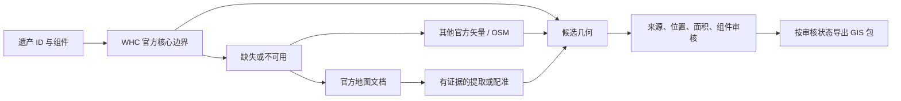

# UNESCO Boundary Workflow

从世界遗产条目到可追溯的 GIS 边界包：先找来源，再核验范围，最后导出。

An evidence-first workflow for UNESCO World Heritage boundaries, combining
source retrieval, official map downloads and reviewed GIS packaging.


[](https://github.com/cloudcollection/unesco-boundary-workflow/actions/workflows/checks.yml)

## 这个仓库做什么

| 功能 | 得到什么 |
|---|---|
| `probe` | WHC 官方图层、OSM 候选、来源记录和待审核清单 |
| `maps` | 官方地图 PDF/图片及下载清单，拒绝把 HTML 当图片 |
| `validate` | 多边形、闭环、坐标范围和椭球面积检查 |
| `package` | 经审核的 GeoJSON、Shapefile、说明和校验文件 |

统一的 [SKILL.md](SKILL.md) 串起这四步。它整合了
`unesco-whc-osm-boundary-retriever`、`unesco-boundary-packager` 和
`UNESCO_Map_SC`；[原仓库盘点](docs/repository-audit.md) 记录了内容、代码问题和迁移关系。



## 快速开始

需要 Python 3.12+。在项目环境中安装：

```bash
git clone https://github.com/cloudcollection/unesco-boundary-workflow.git
cd unesco-boundary-workflow
python -m venv .venv
# 激活 .venv 后：Windows 用 .venv\Scripts\Activate.ps1；macOS/Linux 用 source .venv/bin/activate
python -m pip install -r requirements.lock.txt
python -m pip install --no-deps -e .
python scripts/demo.py --out runs/demo
```

演示完全离线，用带孔、多岛和中文属性的**合成数据**检查导出；它不是实际遗产边界。
Windows 临时目录与环境复现方法见 [运行说明](docs/workflow.md)。

真实数据从命名列 CSV/XLSX 开始，格式见 [sites.csv](examples/sites.csv)：

```bash
unesco-boundary probe --input examples/sites.csv --run runs/nara-01 --no-osm --user-agent "MyResearch/1.0 (https://github.com/YOUR_ACCOUNT)"
unesco-boundary maps --unesco-id 870 --run runs/nara-01 --user-agent "MyResearch/1.0 (https://github.com/YOUR_ACCOUNT)"
```

请把 User-Agent 换成自己的联系方式。去掉 `--no-osm` 可查询 OSM 候选。
每个 run 保存响应原文、请求 URL、时间和 SHA-256；加 `--offline` 可重放同一快照。
读取更新后的来源时请用新的 run 目录。

选定几何后，按 [审核说明](references/source-review.md) 填写
[review.template.json](examples/review.template.json)，再导出：

```bash
unesco-boundary validate source.geojson
unesco-boundary package --geojson source.geojson --review review.json --out-root outputs
```

## 输出与边界

每个遗产保存为 `outputs/<status>/<本地ID>_<名称>/`，包含同名的
`.md .geojson .shp .shx .dbf .prj .cpg`，以及 `review.json`、
`validation.json`、`checksums.json`。原始属性保存在 GeoJSON，DBF 保留精简索引。

| 状态 | 含义 |
|---|---|
| `correct` | 审核人确认核心范围、来源、位置、面积及全部组件 |
| `partial` | 只有部分组件或仅可作参考 |
| `review_needed` | 范围、配准或其他证据仍有不确定性 |

下载成功、名称相似和几何有效都不足以证明边界正确。没有可信多边形就报告缺失，
不生成圆、框或猜测范围。PDF 配准、复杂 OSM 关系拼接和官方替代来源判断仍需
GIS 操作与审核；比例尺加中心点的结果不能进入 `correct`。

## 验证与来源

```bash
python -m pytest -q
python scripts/check_skill.py
```

测试覆盖离线重放、下载错误、审核与文件绑定，以及多岛、孔洞和中文属性的导出回读。
联网来源会变化，软件测试通过不等于某个遗产的边界已获认证。

[设计参考](docs/design-references.md) · [复现与运行](docs/workflow.md) · [代码审阅](docs/repository-audit.md) · [验证记录](docs/validation.md)

新增代码和文档采用 [MIT](LICENSE)；注明的改写模块保留
[Apache 2.0](licenses/Apache-2.0.txt)，详见 [NOTICE](NOTICE)。地图和地理数据遵循各自发布方条款。
