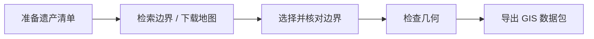

# UNESCO Boundary Workflow

检索世界遗产边界、下载官方地图，将选定的几何数据整理成可在 QGIS、ArcGIS 中使用的 GeoJSON 和 Shapefile。

适用于世界遗产空间研究、GIS 课程练习，以及需要统一整理多个遗产边界的项目。既可以在终端运行，也可以作为 Python 库调用。


[](https://github.com/cloudcollection/unesco-boundary-workflow/actions/workflows/checks.yml)

## 可以做什么

| 命令 | 用途 | 结果 |
|---|---|---|
| `probe` | 按遗产清单检索 WHC 官方图层和 OSM 候选 | 候选 GeoJSON、来源记录、检索汇总 |
| `maps` | 下载官方 maps 页面链接的 PDF 和图片 | 地图文件及下载清单 |
| `validate` | 检查几何、闭环和坐标范围，计算面积 | 几何检查结果 |
| `package` | 将选定的边界与审核记录一起导出 | GeoJSON、Shapefile、说明与校验文件 |



## 安装与第一次运行

需要 Python 3.12 或更新版本。在终端中运行：

```bash
git clone https://github.com/cloudcollection/unesco-boundary-workflow.git
cd unesco-boundary-workflow
python -m venv .venv
```

激活环境：Windows PowerShell 使用 `.\.venv\Scripts\Activate.ps1`；macOS/Linux 使用 `source .venv/bin/activate`。然后安装并运行离线示例：

```bash
python -m pip install -r requirements.lock.txt
python -m pip install --no-deps -e .
python scripts/demo.py --out runs/demo
```

示例使用合成几何，不需要联网。生成的数据包位于：

```text
runs/demo/packages/review_needed/1_Synthetic demo/
```

在 QGIS 中打开其中的 `.geojson` 或 `.shp`，即可查看带孔洞的多岛几何。再次运行时请换一个输出目录，例如 `runs/demo-02`。

## 处理真实遗产

准备 CSV 或 XLSX，至少包含以下三列；示例见 [sites.csv](examples/sites.csv)：

| id | unesco_id | site_name |
|---|---|---|
| 615 | 870 | Historic Monuments of Ancient Nara |

`id` 是项目自定编号，`unesco_id` 是 UNESCO 官方遗产编号。两者可以不同。

先查询官方边界，再按需下载地图。把 `YOUR_ACCOUNT` 换成自己的公开项目或个人主页地址：

```bash
unesco-boundary probe --input examples/sites.csv --run runs/nara-01 --no-osm --user-agent "BoundaryStudy/1.0 (https://github.com/YOUR_ACCOUNT)"
unesco-boundary maps --unesco-id 870 --run runs/nara-01 --user-agent "BoundaryStudy/1.0 (https://github.com/YOUR_ACCOUNT)"
```

检索汇总保存在 `runs/nara-01/retrieval.md`，候选边界在 `candidates/`，地图文档在 `maps/`。去掉 `--no-osm` 可检索 OSM 候选；官方图层为空时仍需选择其他边界来源。

选定边界后，完成 [审核与导出步骤](docs/workflow.md#3-选择边界并填写审核记录)，再运行：

```bash
unesco-boundary validate source.geojson
unesco-boundary package --geojson source.geojson --review review.json --out-root outputs
```

这里的 `source.geojson` 和 `review.json` 分别是你选定的边界和填写完成的审核文件。地图 PDF/图片转成矢量边界、配准和复杂 OSM 关系拼接需要另行使用 GIS 工具完成。

## 得到什么文件

每个遗产对应一个 `outputs/<状态>/<本地编号>_<名称>/` 文件夹：

| 文件 | 用途 |
|---|---|
| 同名 `.geojson` | 完整几何和原始属性 |
| 同名 `.shp .shx .dbf .prj .cpg` | Shapefile，可在 GIS 软件中打开；这些文件需一起保留 |
| 同名 `.md`、`review.json` | 边界来源、范围与审核说明 |
| `validation.json`、`checksums.json` | 几何检查结果和文件校验值 |

状态分为 `correct`（已完成范围与组件核对）、`partial`（部分组件）和 `review_needed`（待进一步核对）。输入几何使用 WGS84 经纬度，支持 Polygon 和 MultiPolygon。

[完整使用教程与 Python 调用](docs/workflow.md) · [Agent 工作流](SKILL.md)
